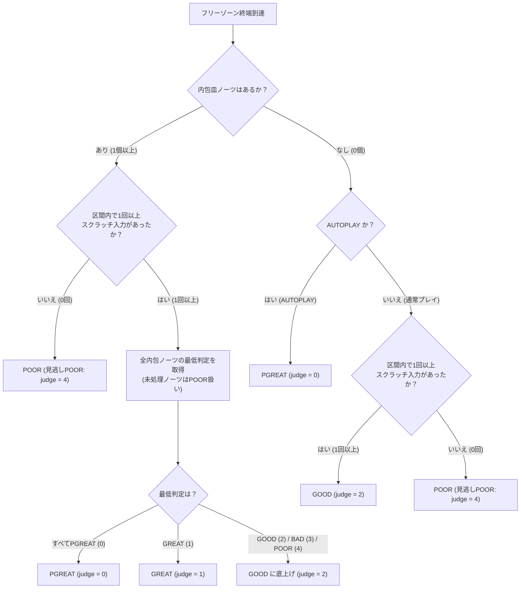

# スクラッチ・フリーゾーン（FREE-ZONE）実装仕様書

BM98時代のフリーゾーン（チャンネル `17` / `27`）および KaleidBeat 拡張の明示形式（チャンネル `SF` / `SG` / `SH` / `SI`）を LR2oraja に実装するための仕様書です。

---

## 1. 概要

**フリーゾーン（FREE-ZONE）** は、指定された区間内でターンテーブル（スクラッチ）を自由に回してよい特殊区間です。

* **ノーツ計上**：
  * 1つの連続したフリーゾーン区間は、その長さや内包する皿ノーツの個数に関わらず、**演奏すべき1個の通常皿ノーツ（`TOTALNOTES_SCRATCH`）** として計上されます。
  * フリーゾーンの閉区間 $[S_{\text{start}}, S_{\text{end}}]$（始点・終点ちょうどの位置を含む）内に配置された通常の皿ノーツ（`#xxx16` / `#xxx26` の [`NormalNote`](file:///d:/Dropbox/GitHub/lr2oraja-endlessdream-rian/core/dependencies/jbms-parser/src/bms/model/NormalNote.java)）は、画面上はフリーゾーン帯に重なって表示されますが、**総ノーツ数には計上されません**。
* **競合ノーツ（BSS・地雷）の扱い**：
  * **BSS（ロングスクラッチ：`#xxx56` / `#xxx66` / `#LNOBJ` 等）**：フリーゾーン区間内にBSSが存在する場合でも、**フリーゾーン自体はそのまま維持・描画され、その中にBSSのオブジェが重なって表示されます**（BSS自体もそのまま維持されます）。
  * **地雷ノーツ（`#xxxD6` / `#xxxE6` の [`MineNote`](file:///d:/Dropbox/GitHub/lr2oraja-endlessdream-rian/core/dependencies/jbms-parser/src/bms/model/MineNote.java)）**：そのまま維持・表示し、フリーゾーン内であっても通過時にスクラッチ入力状態であれば通常通りダメージを受けます。
* **発音・空POOR抑止**：
  * フリーゾーン定義自体（`17` / `27` / `SF`〜`SI`）に記述されたWAV IDは**区間マーカーとして無音扱い**とします。
  * フリーゾーン区間内でのスクラッチ入力では**空POORは一切発生しません**。内包される皿ノーツ（`#xxx16` / `#xxx26`）をヒットした際はその皿ノーツのキー音を再生し、ノーツ自体は消滅させずにそのまま通過させます。
* **判定確定**：
  * 旧形式・明示形式ともに共通の判定ロジックを用い、フリーゾーンの**終端時刻（$S_{\text{end}}$）で1回のみ**最終判定を発生させます。
* **描画**：
  * フリーゾーンの範囲内では、スクラッチレーンの背景色が暗い赤色（`#3B0808`）で描画され、その上に内部の皿ノーツやBSSオブジェが重なって表示されます。

---

## 2. BMSチャンネル仕様とデコード規則

### 2.1 対応チャンネル一覧

36進数チャンネル番号（[`ChartDecoder.parseInt36`](file:///d:/Dropbox/GitHub/lr2oraja-endlessdream-rian/core/dependencies/jbms-parser/src/bms/model/ChartDecoder.java)）における定義は以下の通りです。

| 形式 | チャンネル | 36進数値 (10進) | 対象サイド | 指定方式 | 年代推定 |
| :--- | :---: | :---: | :---: | :--- | :---: |
| **旧形式 (BM98)** | `#xxx17` | `17` (43) | 1P 皿 | 単発配置（4分音符1個分、延長あり） | **要**（2000/12/31まで） |
| **旧形式 (BM98)** | `#xxx27` | `27` (79) | 2P 皿 | 単発配置（4分音符1個分、延長あり） | **要**（2000/12/31まで） |
| **明示形式 (KaleidBeat)** | `#xxxSF` | `SF` (1023) | 1P 皿 | 単発配置（4分音符1個分、延長あり） | 不要（常に有効） |
| **明示形式 (KaleidBeat)** | `#xxxSG` | `SG` (1024) | 1P 皿 | 始点/終点ペア指定（LNTYPE 1相当） | 不要（常に有効） |
| **明示形式 (KaleidBeat)** | `#xxxSH` | `SH` (1025) | 2P 皿 | 単発配置（4分音符1個分、延長あり） | 不要（常に有効） |
| **明示形式 (KaleidBeat)** | `#xxxSI` | `SI` (1026) | 2P 皿 | 始点/終点ペア指定（LNTYPE 1相当） | 不要（常に有効） |

* **対象スクラッチレーン番号**：
  * 5鍵 / 10鍵モード ([`Mode.BEAT_5K`](file:///d:/Dropbox/GitHub/lr2oraja-endlessdream-rian/core/dependencies/jbms-parser/src/bms/model/Mode.java#L10), [`Mode.BEAT_10K`](file:///d:/Dropbox/GitHub/lr2oraja-endlessdream-rian/core/dependencies/jbms-parser/src/bms/model/Mode.java#L12))：1P皿 = レーン `5`、2P皿 = レーン `11`
  * 7鍵 / 14鍵モード ([`Mode.BEAT_7K`](file:///d:/Dropbox/GitHub/lr2oraja-endlessdream-rian/core/dependencies/jbms-parser/src/bms/model/Mode.java#L11), [`Mode.BEAT_14K`](file:///d:/Dropbox/GitHub/lr2oraja-endlessdream-rian/core/dependencies/jbms-parser/src/bms/model/Mode.java#L13))：1P皿 = レーン `7`、2P皿 = レーン `15`
* **プレイモード昇格（1P → 2P）**：
  * 2P側フリーゾーン（有効と判定された `#xxx27`、または `#xxxSH` / `#xxxSI`）に非ゼロ定義が存在する場合、他の2Pチャンネルと同様に `BEAT_5K` → `BEAT_10K`、`BEAT_7K` → `BEAT_14K` へモードを変更します。
  * 年代推定によりフリーゾーンと判定されなかった `#xxx27` については、2Pモードへの昇格も行わず完全に読み飛ばします。
* **PMS形式（`.pms` / [`Mode.POPN_9K`](file:///d:/Dropbox/GitHub/lr2oraja-endlessdream-rian/core/dependencies/jbms-parser/src/bms/model/Mode.java#L15)）の扱い**：
  * PMS形式では `#xxx17`（および関連する1P拡張PMSチャンネル）で通常ノーツを配置している譜面が存在するため、**年代に関わらずフリーゾーンとしては扱わず、通常のノーツとして処理**します。
  * [`Section.CHANNELASSIGN_POPN`](file:///d:/Dropbox/GitHub/lr2oraja-endlessdream-rian/core/dependencies/jbms-parser/src/bms/model/Section.java#L316) において、1P側チャンネルを用いた9ボタンPMS配置（`ch16` = 8ボタン \[lane 7\], `ch17` = 9ボタン \[lane 8\], `ch18` = 6ボタン \[lane 5\], `ch19` = 7ボタン \[lane 6\]）を通常ノーツ（不可視 `3x`・LN `5x`・地雷 `Dx` 含む）として割り当てます。

### 2.2 旧形式（17 / 27）の年代推定ロジック

* **判定基準**：
  * BMS譜面（非PMS）において、譜面ファイルの最終更新日時（`Files.getLastModifiedTime(path)`）が **2000年12月31日 23:59:59.999（JST / ローカルタイムゾーン）以前** の場合のみ、`#xxx17` / `#xxx27` をフリーゾーンとして認識します。
  * 更新日時が 2001年1月1日 00:00:00 以降の場合、または [`ChartSource`](file:///d:/Dropbox/GitHub/lr2oraja-endlessdream-rian/core/dependencies/jbms-parser/src/bms/model/ChartSource.java) から更新日時が取得できない（かつ旧形式有効化指定がない）場合は、フリーゾーンとは判定せずその位置のオブジェを読み飛ばします。
  * ※単体テスト等でメモリ上のバイト配列（[`ByteArrayChartSource`](file:///d:/Dropbox/GitHub/lr2oraja-endlessdream-rian/core/dependencies/jbms-parser/src/bms/model/ByteArrayChartSource.java) 等）から検証できるよう、[`ChartSource`](file:///d:/Dropbox/GitHub/lr2oraja-endlessdream-rian/core/dependencies/jbms-parser/src/bms/model/ChartSource.java) または [`BMSDecoder`](file:///d:/Dropbox/GitHub/lr2oraja-endlessdream-rian/core/dependencies/jbms-parser/src/bms/model/BMSDecoder.java) で更新日時（または旧形式有効フラグ）を渡せるインターフェースを用意します。

### 2.3 区間の生成・延長・結合規則

1. **単発宣言（`17`, `27`, `SF`, `SH`）**：
   * オブジェが配置された小節座標（`sectionnum + rate * pos`）を $S_{\text{start}}$ としたとき、四分音符1個分の長さ（$+0.25$）を持つ閉区間 $[S_{\text{start}}, S_{\text{start}} + 0.25]$ を生成します。
2. **ペア宣言（`SG`, `SI`）**：
   * LNTYPE 1 と同様に、奇数回目の非ゼロ定義を始点 $S_{\text{start}}$、偶数回目の非ゼロ定義を終点 $S_{\text{end}}$ として閉区間 $[S_{\text{start}}, S_{\text{end}}]$ を生成します。
   * 曲の終端までに終点が閉じられなかった孤立始点は WARNING ログを出力して破棄します。
3. **延長・結合（マージ）**：
   * 同一スクラッチレーン上で生成されたすべてのフリーゾーン区間 $[S_i, E_i]$ を始点 $S_i$ の昇順に並べ、**前の区間の終点 $E_1$ に対して次の区間の始点 $S_2$ が $S_2 \le E_1$（$S_2 == E_1$ の連続配置を含む）を満たす場合、1つの連続したフリーゾーン $[S_1, \max(E_1, E_2)]$ として結合・延長**します。
   * 旧形式と明示形式、あるいは単発宣言（`SF`/`SH`）とペア宣言（`SG`/`SI`）が重なったり隣接した場合も同様に結合します。
   * 各フリーゾーンの始点 `section` および終点 `section` には、対応する [`TimeLine`](file:///d:/Dropbox/GitHub/lr2oraja-endlessdream-rian/core/dependencies/jbms-parser/src/bms/model/TimeLine.java) を確実に生成（`getOrCreateTimeLine`）します。
4. **内包される皿ノーツ・BSS・地雷の扱い**：
   * 結合確定後の各フリーゾーン閉区間 $[S_{\text{start}}, S_{\text{end}}]$ に対し、同一スクラッチレーン上で `S_start <= tl.getSection() && tl.getSection() <= S_end` を満たす [`NormalNote`](file:///d:/Dropbox/GitHub/lr2oraja-endlessdream-rian/core/dependencies/jbms-parser/src/bms/model/NormalNote.java) を「フリーゾーン内包皿ノーツ（`freeZoneInner = true`）」としてマークし、当該フリーゾーンに関連付けます。
   * 区間内に [`LongNote`](file:///d:/Dropbox/GitHub/lr2oraja-endlessdream-rian/core/dependencies/jbms-parser/src/bms/model/LongNote.java)（BSS）が存在する場合、フリーゾーンもBSSも削らずに両方を維持し、フリーゾーンの背景帯の中にBSSのオブジェが重なって表示され、BSS自体はそのままBSSとして動作・計上します。
   * 区間内に [`MineNote`](file:///d:/Dropbox/GitHub/lr2oraja-endlessdream-rian/core/dependencies/jbms-parser/src/bms/model/MineNote.java)（地雷）が存在する場合もそのまま維持し、踏むとダメージになります。

---

## 3. データモデル・総ノーツ数・特徴フラグ設計

### 3.1 モデル表現（`bms.model`）
* フリーゾーンの始点・終点と全く同じタイムライン上に `#xxx16` / `#xxx26` の皿ノーツやBSS・地雷が配置されていても互いに上書きせず共存できるよう、[`TimeLine.notes`](file:///d:/Dropbox/GitHub/lr2oraja-endlessdream-rian/core/dependencies/jbms-parser/src/bms/model/TimeLine.java#L23) には既存のノーツ（`NormalNote` / `LongNote` / `MineNote`）をそのまま保持し、フリーゾーンは以下の構造で表現します。
  * **`FreeZone`（または `FreeZoneNote extends Note`）クラスの新設**：
    * 始点 `TimeLine`（または始点 `section` / `microTime`）、終点 `TimeLine`（または終点 `section` / `microTime`）、対象レーン `lane`、および内包される `NormalNote[]` 一覧を保持します。
    * [`TimeLine`](file:///d:/Dropbox/GitHub/lr2oraja-endlessdream-rian/core/dependencies/jbms-parser/src/bms/model/TimeLine.java) にレーン別のフリーゾーン始点・終点参照（および [`BMSModel`](file:///d:/Dropbox/GitHub/lr2oraja-endlessdream-rian/core/dependencies/jbms-parser/src/bms/model/BMSModel.java) / [`Lane`](file:///d:/Dropbox/GitHub/lr2oraja-endlessdream-rian/core/dependencies/jbms-parser/src/bms/model/Lane.java) にレーンごとの `FreeZone[]`）を持たせ、[`NormalNote`](file:///d:/Dropbox/GitHub/lr2oraja-endlessdream-rian/core/dependencies/jbms-parser/src/bms/model/NormalNote.java) に `boolean freeZoneInner`（フリーゾーン内包フラグ）を持たせます。

### 3.2 総ノーツ数・ノーツ内訳（[`TimeLine`](file:///d:/Dropbox/GitHub/lr2oraja-endlessdream-rian/core/dependencies/jbms-parser/src/bms/model/TimeLine.java) / [`BMSModelUtils`](file:///d:/Dropbox/GitHub/lr2oraja-endlessdream-rian/core/dependencies/jbms-parser/src/bms/model/BMSModelUtils.java) / [`SongInformation`](file:///d:/Dropbox/GitHub/lr2oraja-endlessdream-rian/core/src/bms/player/beatoraja/song/SongInformation.java)）
* **フリーゾーン本体**：
  * 1個のフリーゾーンにつき **1個の通常皿ノーツ（`TOTALNOTES_SCRATCH`）** としてカウントします。
* **内包皿ノーツ（`freeZoneInner == true` の `NormalNote`）**：
  * [`TimeLine.getTotalNotes()`](file:///d:/Dropbox/GitHub/lr2oraja-endlessdream-rian/core/dependencies/jbms-parser/src/bms/model/TimeLine.java#L139)、[`BMSModelUtils.getTotalNotes()`](file:///d:/Dropbox/GitHub/lr2oraja-endlessdream-rian/core/dependencies/jbms-parser/src/bms/model/BMSModelUtils.java#L66)、[`SongInformation`](file:///d:/Dropbox/GitHub/lr2oraja-endlessdream-rian/core/src/bms/player/beatoraja/song/SongInformation.java) の密度・レーン別ノーツ数計算において、カウント対象から除外します（代わりにフリーゾーン本体を通常皿1個として計上）。
* **最終ノーツ時刻（[`BMSModel.getLastTime()`](file:///d:/Dropbox/GitHub/lr2oraja-endlessdream-rian/core/dependencies/jbms-parser/src/bms/model/BMSModel.java#L290) / [`getLastNoteTime()`](file:///d:/Dropbox/GitHub/lr2oraja-endlessdream-rian/core/dependencies/jbms-parser/src/bms/model/BMSModel.java#L309)）**：
  * フリーゾーンの終点が存在するタイムラインも `existNote` 相当として最終ノーツ時刻の対象に含めます。

### 3.3 譜面特徴フラグ・ハッシュ表現（[`SongData`](file:///d:/Dropbox/GitHub/lr2oraja-endlessdream-rian/core/src/bms/player/beatoraja/song/SongData.java) / [`IRChartData`](file:///d:/Dropbox/GitHub/lr2oraja-endlessdream-rian/core/src/bms/player/beatoraja/ir/IRChartData.java) / [`BMSModel`](file:///d:/Dropbox/GitHub/lr2oraja-endlessdream-rian/core/dependencies/jbms-parser/src/bms/model/BMSModel.java)）
* [`BMSModel.containsFreeZone()`](file:///d:/Dropbox/GitHub/lr2oraja-endlessdream-rian/core/dependencies/jbms-parser/src/bms/model/BMSModel.java)：譜面内にフリーゾーンが存在するかを返すメソッドを追加します。
* [`BMSModel.toChartString()`](file:///d:/Dropbox/GitHub/lr2oraja-endlessdream-rian/core/dependencies/jbms-parser/src/bms/model/BMSModel.java#L552)：フリーゾーン始点に `F` + 継続時間（`ms`）の識別子を出力し、`charthash` に反映させます。
* [`SongData`](file:///d:/Dropbox/GitHub/lr2oraja-endlessdream-rian/core/src/bms/player/beatoraja/song/SongData.java)：`FEATURE_FREEZONE = 1024` および `hasFreeZone()` を追加します。
* [`IRChartData`](file:///d:/Dropbox/GitHub/lr2oraja-endlessdream-rian/core/src/bms/player/beatoraja/ir/IRChartData.java)：`public final boolean hasFreeZone` フィールドを追加します。

---

## 4. 判定・演奏ロジック（[`JudgeManager`](file:///d:/Dropbox/GitHub/lr2oraja-endlessdream-rian/core/src/bms/player/beatoraja/play/JudgeManager.java)）

旧形式（`17` / `27`）と明示形式（`SF`〜`SI`）で完全に共通の判定ロジックを使用します。

### 4.1 フリーゾーン区間内の入力と内包皿ノーツの内部判定

1. **スクラッチ入力の記録（`scratched` フラグ）**：
   * フリーゾーンの有効期間（始点時刻 `startTime` の早GOOD/BAD窓、または始点時刻〜終点時刻 `endTime`）内に該当スクラッチレーンでキー入力（スクラッチ回転）が1回でも行われた場合、そのフリーゾーンの `scratched = true` を記録します。
   * また、内包皿ノーツをヒットした場合も自動的に `scratched = true` となります。
2. **空POORの抑止**：
   * 現在時刻 `pmtime` がフリーゾーン区間 `[startTime, endTime]` 内にある場合、該当スクラッチレーンでの入力によって通常ノーツがヒットしなかったり、処理済みノーツの空POOR窓に入ったとしても、**空POOR（judge = 5）は発生させません**。
3. **内包皿ノーツの内部判定と通過挙動**：
   * 内包皿ノーツ（`freeZoneInner == true`）がスクラッチ判定窓内でヒットされた場合：
     * その皿ノーツのキー音（`keysound.play(tnote, ...)`）を通常通り再生します。
     * 獲得した判定 `judge`（`0: PGREAT`, `1: GREAT`, `2: GOOD`, `3: BAD`）とズレ時間 `dmtime` を内部状態（`note.setState(judge + 1)`, `note.setMicroPlayTime(dmtime)`）として記録します。
     * **スコア・コンボ・ゲージ・判定文字・ボム・ゴースト更新（`updateMicro`）は呼び出しません**。
     * **ノーツの消滅を行わず**、画面上はそのまま判定ラインを通過させます（[`LaneRenderer`](file:///d:/Dropbox/GitHub/lr2oraja-endlessdream-rian/core/src/bms/player/beatoraja/play/LaneRenderer.java) で `freeZoneInner` のノーツはヒット後も非表示にせず通過描画を維持します）。
   * 内包皿ノーツがヒットされずに見逃しPOOR境界（`mtime + smjudge[3][0]`）を通過した場合：
     * 見逃しPOOR（`state = 5`）として内部記録するのみで、その時点では `updateMicro`（POOR発生）やミス時キー音再生は行いません。

### 4.2 フリーゾーン終端（`endTime`）到達時の確定判定

現在時刻 `mtime` がフリーゾーンの終端時刻 `endTime` に到達したとき（内包皿ノーツに終端付近のノーツがある場合は、終端時刻到達時点または終端上の内包ノーツの判定確定時点）、以下の分岐によって最終判定 `finalJudge` を決定し、`updateMicro` を **1回だけ** 呼び出します。

| ケース | 条件 | 最終確定判定 (`finalJudge`) | 備考 |
| :--- | :--- | :---: | :--- |
| **内包皿ノーツあり (1個以上)** | すべての内包皿ノーツが **PGREAT** | **PGREAT (`0`)** | AUTOPLAY時もすべてPGREATで自動演奏され `PGREAT` となる |
| | すべての内包皿ノーツが **GREAT以上**（最低がGREAT） | **GREAT (`1`)** | |
| | その他で、**区間内に1回以上スクラッチ入力あり** | **GOOD (`2`)** | BADや見逃しがあっても1回でも回していればGOODに底上げ |
| | **区間内で1回もスクラッチ入力なし** | **POOR (`4`)** | 見逃しPOOR（コンボカット・ゲージ減少） |
| **内包皿ノーツなし (0個)** | **AUTOPLAY 時** | **PGREAT (`0`)** | 終端でPGREATを1回発生 |
| | 通常プレイで、**区間内に1回以上スクラッチ入力あり** | **GOOD (`2`)** | 終端でGOODを1回発生 |
| | 通常プレイで、**区間内で1回もスクラッチ入力なし** | **POOR (`4`)** | 見逃しPOOR（コンボカット・ゲージ減少） |

---

## 5. 描画仕様（[`LaneRenderer`](file:///d:/Dropbox/GitHub/lr2oraja-endlessdream-rian/core/src/bms/player/beatoraja/play/LaneRenderer.java)）

### 5.1 スクラッチレーン背景の暗い赤色描画
* **描画色**：`#3B0808`（RGB: `59, 8, 8`, Alpha: `255` — `Color.valueOf("3b0808ff")`）
  * CONSTANT フェードイン有効時は、対象タイムラインのアルファ値を乗算します。
* **描画座標**：
  * X座標：`lanes[lane].region.x + offsetX`
  * 幅：`lanes[lane].region.width + offsetW`
  * Y座標（下端〜上端）：
    * フリーゾーン始点タイムラインの描画Y座標 `startY`（始点が現在時刻を通過済みの場合は判定ライン `hl`）から、終点タイムラインの描画Y座標 `endY`（レーン上端 `hu` を超える場合は `hu`）までの区間を塗りつぶします。
* **描画レイヤー順（Zオーダー）**：
  1. **フリーゾーン背景帯（`#3B0808`）** ← 最背面に描画
  2. 判定エリア表示（ShowJudgeArea）
  3. 小節線・BPM線・STOP線・タイムライン線
  4. ノーツ（内包される皿ノーツ、競合するBSSオブジェ、地雷ノーツ等） ← フリーゾーン背景帯の上に重なって描画

### 5.2 内包皿ノーツの通過描画
* フリーゾーンに内包される皿ノーツ（`freeZoneInner == true`）は、プレイヤーがヒットして内部 `state` が更新された後も消滅させず、判定ライン（`hl`）に到達するまで通常の未処理ノーツ画像（`lanes[lane].noteImage`）のまま流れて通過するように描画します。
* また、フリーゾーンの終端が現在時刻を通過するまでは、`LaneRenderer` の描画開始インデックス `pos` がフリーゾーン始点より先に進んで描画が途切れないよう、[`LongNote`](file:///d:/Dropbox/GitHub/lr2oraja-endlessdream-rian/core/src/bms/player/beatoraja/play/LaneRenderer.java#L505) と同様に `pos` を維持します。
